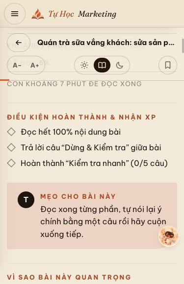
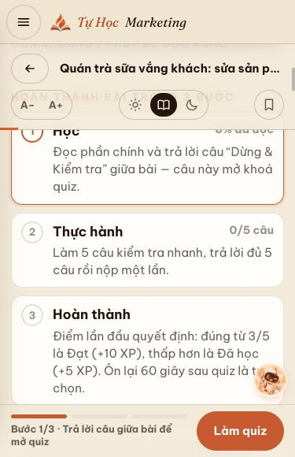
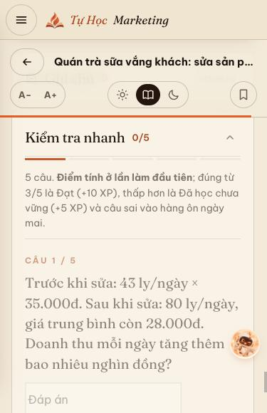
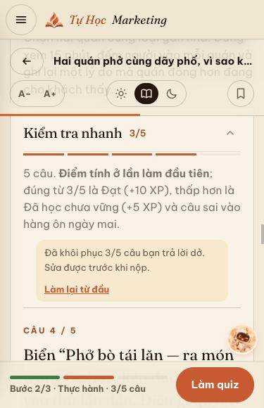
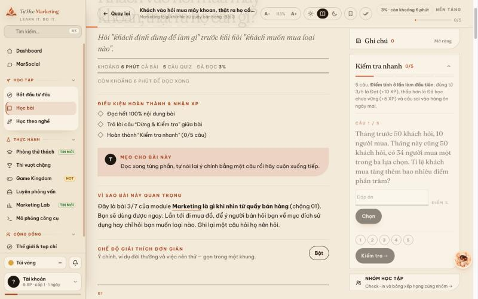
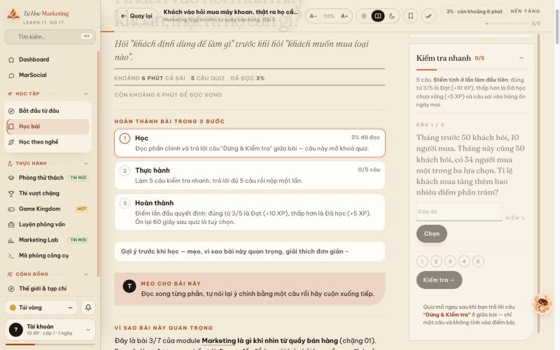
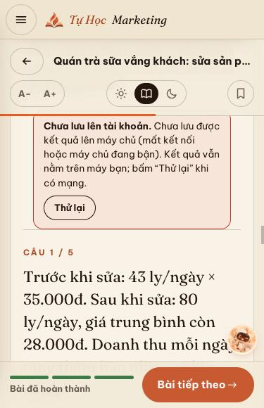

# First Lesson Activation — thay đổi, ảnh trước/sau, kế hoạch đo 7 ngày

Phase 1 của kế hoạch kích hoạt, dựa trên `FUNNEL-AUDIT-2026-10-17.md` (PR docs/funnel-audit-2026-10-17): 30 tài khoản → 28 vào trang Học → 17 mở bài → 8 trả lời câu giữa bài → 4 qua "Đổ não 60 giây" → **1 hoàn thành**. Không có lỗi ghi nhận; điểm rớt là cuối bài và quiz nằm quá xa trên mobile.

Phạm vi: chỉ `bai.html` (+ test). Không đổi API, schema D1, dữ liệu bài học, chuẩn chấm. Yêu cầu tối thiểu 5 câu quiz để hoàn thành và việc server chấm điểm lần đầu giữ nguyên.

## Thay đổi
| # | Trước | Sau |
|---|---|---|
| 1 | Quiz nằm ở cột phụ; trên mobile bị đẩy xuống dưới Góp ý, Case study, Sổ tay (màn hình thứ 12,1) | Trên màn ≤1020px quiz nằm ngay sau phần học chính (màn hình thứ 6,8), trước Luyện tập, Ôn lại, Góp ý, Case, Sổ tay. Trên desktop vẫn ở cột phụ |
| 2 | Không có CTA cố định | Thanh đáy cố định trên mobile: "Bước x/3 · …" + nút "Làm quiz" (hoặc "Nộp bài", "Bài tiếp theo"). Tự ẩn khi quiz đang trên màn hình hoặc khi đang gõ; trang chừa chỗ phía dưới nên không che nội dung; không chạm nút Ý Ý (cách đáy 62px so với 70px) |
| 3 | Danh sách điều kiện 3 dòng, không nhắc bước chặn quiz | Thẻ "Hoàn thành bài trong 3 bước": Học → Thực hành → Hoàn thành, mỗi bước nói rõ điều kiện, tiến độ (0/5 câu, % đọc), bấm/Enter để nhảy tới bước |
| 4 | Quiz khoá cho tới khi qua "Đổ não 60 giây" (người học không được báo) | Quiz mở ngay sau khi trả lời câu "Dừng & Kiểm tra" giữa bài (câu không tính điểm); ghi chú khoá nói đúng điều kiện và có link tới câu đó |
| 5 | "Đổ não 60 giây" nằm trước quiz | Thành "Ôn lại 60 giây · sau khi làm quiz", tuỳ chọn, không ảnh hưởng điểm hay hoàn thành |
| 6 | Quiz dở mất khi rời trang | Chọn đến đâu lưu đến đó (khoá trạng thái `qd`, cùng cơ chế đồng bộ tiến độ). Vào lại thì khôi phục, đặt về câu chưa làm, có nút "Làm lại từ đầu" |
| 7 | `/lessons/:key/complete` bị nuốt lỗi (`.catch(()=>{})`) | Chờ kết quả; lỗi thì hiện khung báo theo nguyên nhân (401/409/mạng) kèm "Thử lại", ghi `pend` để tự thử lại lần mở trang sau. Không tạo hoàn thành giả: điểm lần đầu vẫn chỉ được ghi khi quiz đã nộp và chấm |
| 8 | Ba thẻ Mẹo / Vì sao quan trọng / Giải thích đơn giản đẩy câu giữa bài xuống màn thứ 4,0 | Gom vào một mục gập (mở sẵn trên desktop, gập trên mobile); không bỏ nội dung. Câu giữa bài lên màn thứ 2,8 |

Nội dung cốt lõi (khái niệm, ví dụ, vì sao hiệu quả, phản ví dụ, góc nhìn đào sâu, lỗi hay gặp, Luyện tập, Thực hành, Ôn lại, Case, Sổ tay) vẫn nguyên; chỉ đổi thứ tự, nhãn và cách hiển thị.

## Ảnh trước / sau
Mobile 375px — đầu bài (thẻ điều kiện cũ → 3 bước + thanh CTA):

| Trước | Sau |
|---|---|
|  |  |

Mobile — vị trí quiz (trước: cuối trang; sau: khôi phục nháp 3/5 câu, CTA "Làm quiz"):

| Trước | Sau |
|---|---|
|  |  |

Desktop 1440px (sau khi sửa quiz ở cột phụ, nội dung chính không đổi):

| Trước | Sau |
|---|---|
|  |  |

Lỗi `/complete` (giả lập 503 để kiểm tra) — báo rõ, không im lặng:



Đo trên cùng bài `B:ob01-02`, mobile 375px: vị trí quiz 8.693px → 5.041px (11,7 → 6,8 màn hình), tổng trang 9.623px → 9.553px.

## QA đã chạy
- Regression: `node --test tests/*.test.mjs` 143/143 (+ test mới `tests/first-lesson-activation.test.mjs`), `cd api && npm test` 43/43, `node tools_validate_bai.mjs` 712 bài 0 lỗi.
- Trình duyệt (desktop 1440px và mobile 375px): trả lời câu giữa bài mở quiz; chọn 3/5 câu rồi tải lại → khôi phục đúng 3 câu, kể cả câu điền số; nộp bài → hoàn thành, bài đã làm hiện đủ 3 bước ✓ sau tải lại; `/complete` lỗi → khung báo + `pend`, bấm "Thử lại" → lưu được, `pend` rỗng; bài loại `L:` hiển thị đúng với quiz 3 và 5 câu; bài `P:` khoá chặng vẫn hiện trang khoá như cũ; không tràn ngang.
- Không ghi D1 production, không tạo hoàn thành giả hay sửa dữ liệu học viên (mọi thử nghiệm dùng localStorage của server preview cục bộ; các lệnh D1 production chỉ là `SELECT` tổng hợp để lấy baseline).
- Sự kiện đo: kiểm bằng spy `fetch` trong trình duyệt, ra đúng `gate_done`, `quiz_view`, `quiz_submit`, `lesson_done`, mỗi loại một lần.

## Kế hoạch đo activation 7 ngày
Không đổi schema. Dùng các bảng có sẵn (`users`, `answer_events`, `lesson_progress`, `app_events`) và hai khoá mới `qd`, `pend` trong `user_state`. Bổ sung sự kiện theo bước qua `/api/track` có sẵn (ghi vào `app_events`): `lesson_open`, `gate_done`, `quiz_view`, `quiz_submit`, `lesson_done`, `sync_error`, mỗi sự kiện một lần cho mỗi lần mở trang, `target` là mã bài (ví dụ `B:ob01-01`). Chỉ truy vấn tổng hợp, không lấy email/tên/id.

**Mốc:** `T0` = thời điểm deploy. **Baseline** (2026-10-17, 30 tài khoản, đo từ D1 production chỉ đọc): vào trang Học 28; mở bài 17 (`app_events`, 45 lượt xem `bai.html`, chưa kèm mã bài); trả lời câu giữa bài 8; qua Đổ não 4; hoàn thành bài đầu 1/30 (3%) → câu giữa bài → nộp quiz = 1/8.

**Chỉ số chính (nhóm đăng ký sau `T0`):**
1. *Activation 7 ngày* = tỉ lệ tài khoản có ≥1 dòng `lesson_progress` với `completion_source='lesson'` trong 7 ngày sau đăng ký. Mục tiêu ≥ 20% (baseline 3%).
2. *Câu giữa bài → nộp quiz* = số người có câu `lesson` trong `answer_events` ÷ số người có câu `checkpoint`. Mục tiêu ≥ 50% (baseline 1/8).
3. *Mở bài → câu giữa bài* (baseline 8/17 = 47%) tăng lên ≥ 60%.

**Chỉ số theo dõi mới:**
- *Bỏ dở quiz* = số người có `user_state.state_json.qd` khác rỗng (đã chọn đáp án nhưng chưa nộp). Cao → quiz còn khó hoặc quá dài.
- *Lưu server lỗi* = số người có `pend` khác rỗng. Mục tiêu 0 sau 24 giờ; còn >0 → điều tra `/complete`.
- *Ôn lại sau quiz* (`state.recall`) — chỉ ghi nhận, không phải mục tiêu (nay là tuỳ chọn).

**Ràng buộc chất lượng (không được xấu đi):**
- Điểm lần đầu trung bình (`lesson_progress.first_score`, nguồn `lesson`) không giảm quá 10 điểm so với baseline.
- `sync_error` chiếm ≤ 5% số `lesson_done + sync_error`.
- Không có tăng lỗi 5xx ở `/api/lessons/*/complete` và `/api/answers`; không có tăng bất thường lượng ghi `app_events` (giới hạn chống dội 120 sự kiện / 10 phút mỗi người vẫn áp dụng).

**Truy vấn mẫu (chỉ đọc; thay `:t0` bằng mili-giây của `T0`):**
```sql
-- 1) Phễu nhóm đăng ký sau T0
SELECT
 (SELECT COUNT(*) FROM users WHERE created_at >= :t0 AND email NOT LIKE '%@system.invalid') AS registered,
 (SELECT COUNT(DISTINCT a.user_id) FROM answer_events a JOIN users u ON u.id=a.user_id WHERE u.created_at >= :t0 AND a.context='checkpoint') AS checkpoint_users,
 (SELECT COUNT(DISTINCT a.user_id) FROM answer_events a JOIN users u ON u.id=a.user_id WHERE u.created_at >= :t0 AND a.context='lesson') AS quiz_submitted_users,
 (SELECT COUNT(DISTINCT lp.user_id) FROM lesson_progress lp JOIN users u ON u.id=lp.user_id WHERE u.created_at >= :t0 AND lp.completion_source='lesson') AS completed_users;
-- 1b) Phễu theo từng bước từ sự kiện mới (từ T0; một dòng = số người khác nhau ở bước đó)
SELECT kind, COUNT(DISTINCT user_id) AS users, COUNT(*) AS events FROM app_events
 WHERE created_at >= :t0 AND kind IN ('lesson_open','gate_done','quiz_view','quiz_submit','lesson_done','sync_error') GROUP BY kind;
-- 1c) Cùng phễu cho riêng bài đầu tiên
SELECT kind, COUNT(DISTINCT user_id) AS users FROM app_events
 WHERE created_at >= :t0 AND target = 'B:ob01-01' AND kind IN ('lesson_open','gate_done','quiz_view','quiz_submit','lesson_done','sync_error') GROUP BY kind;
-- 2) Bỏ dở quiz và lưu server lỗi (ảnh chụp hiện tại)
SELECT
 (SELECT COUNT(*) FROM user_state WHERE json_extract(state_json,'$.qd') IS NOT NULL AND json_extract(state_json,'$.qd')<>'{}') AS qd_open,
 (SELECT COUNT(*) FROM user_state WHERE json_extract(state_json,'$.pend') IS NOT NULL AND json_extract(state_json,'$.pend')<>'{}') AS pend_open;
-- 3) Chất lượng: điểm lần đầu trung bình
SELECT AVG(first_score) AS avg_first, COUNT(*) AS n FROM lesson_progress WHERE completion_source='lesson';
```

**Lịch xem:** ngày 1 (kiểm lỗi, `pend`), ngày 3 (chiều hướng), ngày 7 (kết luận). Mẫu nhỏ (<30 tài khoản mới) thì chỉ kết luận định hướng, ghi rõ khoảng bất định.

**Quy tắc quyết định ngày 7:** activation ≥ 20% → giữ và sang Phase 2 (nhắc quay lại, onboarding thẳng bài 1); 10–20% → giữ, kiểm tra điểm rớt kế tiếp bằng phễu trên; <10% với ≥30 tài khoản mới hoặc ràng buộc chất lượng bị vi phạm → rà lại hoặc hoàn tác theo kế hoạch rollback của PR.

**Rollback tính năng:** thay đổi nằm gọn trong `bai.html`; hoàn tác bằng revert commit và deploy lại, hoặc rollback Worker về phiên bản trước. Khoá `qd`/`pend` thừa trong `user_state` vô hại.
